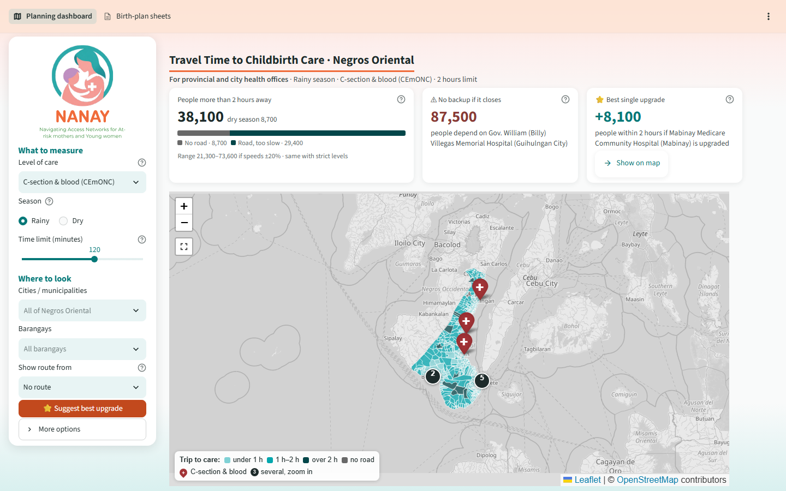

# NANAY: how far are mothers from emergency childbirth care?

NANAY (*Navigating Access Networks for At-risk mothers and Young women*; "nanay" means mother)
estimates how long it takes to travel from each of the 557 barangays of Negros Oriental to the
nearest facility that can handle a childbirth emergency, in the dry and the rainy season, and
suggests which facility upgrades would bring the most people within 2 hours of care.

**Live app:** https://nanay-neg-or.streamlit.app



It has two pages, for two kinds of health workers:

| Page | For | What it answers |
|---|---|---|
| **Planning dashboard** | Provincial and city health offices | Which barangays are far from care, how rain changes that, which facility has no backup, and where an upgrade would help most |
| **Birth-plan sheets** | Midwives and barangay health workers | A printable one-page sheet per barangay: nearest facility for each level of care, its phone number, dry and rainy travel times (one barangay, or a whole town as one PDF) |

Mothers are the people who benefit; they receive the information through the midwife's sheet.
All results describe **areas, not individual women**, and are decision support, not clinical guidance.

---

## Key results (rainy season, C-section care (CEmONC), 2-hour limit)

These are model estimates (see Known limits). People = all ages, PSA 2020 Census.

- **38,140 people (2.7%) live more than 2 hours** from a hospital that can do a caesarean section
  and give blood. In the **dry season: 8,723 (0.6%)**.
- **All 8,723 dry-season people live in 6 barangays our road data does not reach** (Apo Island,
  Olympia, and 4 upland Guihulngan barangays). Everyone with a road is within 2 hours in the dry
  season. The rainy season adds 12 barangays (29,417 people) that have a road but are too slow.
- **How sure:** with every assumed speed 20% slower or faster, the rainy number ranges from
  21,348 to 73,603. Counting private hospitals as basic care only (strict scenario) gives the
  same 38,140, so this result does not depend on how private hospitals are classified.
- **Border effect:** 24,634 of the 38,140 live in the 11 towns bordering Negros Occidental, whose
  hospitals are not in our model, so part of this gap may be overstated.
- **No backup:** if Gov. William (Billy) Villegas Memorial Hospital (Guihulngan City) closed,
  87,483 people would have no other C-section hospital within 2 hours.
- **Best upgrades (Maximal Covering Location Problem):** adding C-section capacity at Mabinay
  Medicare Community Hospital would bring 8,145 more people within 2 hours; the best 3 sites
  together, 19,619 (coverage 97.3% → 98.7%). Cost and staffing are not modelled.

---

## Using the app

**Planning dashboard**
1. **Left panel, "What to measure":** pick the level of care (C-section and blood, basic emergency
   care, or any place to give birth), the season (rainy or dry) and the time limit (default 2 hours).
2. **"Where to look":** pick cities/municipalities or barangays to zoom every number to that area;
   "Show route from" draws the fastest road path to the 3 nearest facilities. "Clear all" resets.
3. **The three tiles** answer: how many people are beyond the limit (split into "no road" and
   "road, too slow", with the ±20% range), which facility has no backup, and the best single upgrade
   ("Show on map" adds it as a what-if).
4. **The map:** colors = trip time to care; pins = facilities; hover over a barangay for details;
   the button under + / − makes the map fill the window (Esc to go back).
5. **The tabs under the map:** cities and municipalities (dry vs rainy chart and table), the best
   1-3 upgrades, the barangay ranking, existing facilities (who loses access if one closes; ◆ marks
   the province's own CEmONC sites at Bayawan and Guihulngan, Provincial Government of Negros
   Oriental, n.d.),
   barangays with no road, and "About the data" (sources, assumptions, limits). Tables download as CSV.

**Birth-plan sheets:** pick a town and barangay (it opens on the place picked on the dashboard),
check the preview, then download one sheet or all barangays of the town as one PDF to print.
The midwife fills in the blank lines (local emergency numbers, the mother's own plan) by hand.

---

## How the model works

1. **Facilities:** DOH National Health Facility Registry (Department of Health, 2026), which has no
   coordinates and no BEmONC/CEmONC field.
   The team located each facility on a map. Care level assumed from type: hospital = CEmONC
   (C-section and blood; hospitals must have an operating room and a blood station; Department of Health, 2012),
   infirmary = BEmONC (basic emergency care), birthing home = birthing.
2. **Barangays:** official boundaries (National Mapping and Resource Information Authority &
   Philippine Statistics Authority, 2025); one point inside each barangay; population from the
   2020 Census (Philippine Statistics Authority, 2021).
3. **Trip:** walk from the barangay point to the nearest road (4 km/h), ride the fastest road route
   on OpenStreetMap (OpenStreetMap contributors, 2026; extract from Geofabrik GmbH, 2026), with an
   assumed speed per road type and Dijkstra's shortest path (road network built with OSMnx;
   Boeing, 2017), then walk to the facility. A barangay more than 8 km from a road, on a road
   piece cut off from the network, or across the sea counts as "no road".
4. **Rainy season:** every road type is slowed by an assumed factor; dirt roads the most.
5. **Covered:** a trip within the time limit (default 2 hours, the benchmark for timely access to
   caesarean section; Meara et al., 2015).
6. **Upgrades:** the Maximal Covering Location Problem (Church & ReVelle, 1974), solved with PuLP,
   picks the rural health units, birthing homes or infirmaries whose upgrade covers the most people.
7. **Checks:** the headline is recounted with all speeds ±20%, and under the strict care-level scenario.

Every assumption (speeds, rain factors, care levels, limits) is labelled in `config.py`.

## How it was tested

- **21 automated tests** of the core calculations (`python -m pytest tests`), e.g. travel times on a
  known road, rain never making a road faster, the upgrade search picking the site that covers more people.
- **Rules the results must obey,** checked on the real data: rainy trips are never faster than dry
  ones; a lower level of care is never farther away than a higher one; a longer time limit never
  leaves more people beyond it; the town totals add up to the headline; the best 3 upgrades never
  help fewer people than the best 2. No travel time implies an impossible speed.
- **94 combinations of settings** (every level, season, time limit and scenario; every town alone;
  single barangays; the 3D view; the upgrade buttons; both pages) run without errors.
- **All 557 birth-plan sheets** generate as exactly one A4 page each.
- **Data checks:** every facility point inside the province lies in the town the registry lists
  (three coastal points just outside the province outline were checked by hand); the barangay
  populations add up to the official PSA province total (1,432,990).

## Challenges and how we handled them

| Challenge | What we did |
|---|---|
| The online road download (Overpass) kept timing out | Built the road network offline from the Geofabrik extract of OpenStreetMap (script 02b) |
| The DOH registry has no coordinates | The team located every facility on a map; a helper script suggests OpenStreetMap coordinates to check by hand (01a) |
| No public list of BEmONC/CEmONC facilities | Care level assumed from facility type, labelled everywhere, and tested with a stricter scenario |
| Travel speeds and rain slowdowns are not measured | Every assumption is labelled in `config.py`, and the headline is recounted with all speeds ±20% |
| Straight-line walks crossed the sea for island barangays | A sea check marks them "no road connection" (they need a boat) |
| Roads stop at the province border | The 11 border towns are found from official boundaries (script 03c) and flagged in the app |
| The map was slow with full-detail boundaries | Boundaries simplified to about 40 m detail (6.8 MB to about 0.3 MB) and travel times computed in advance |

## Future directions and real-world use

**How a health office could use it now:** find barangays that need a transport or boat plan before
the rainy season, compare upgrade options before budgeting, see which hospitals have no backup, and
print birth-plan sheets for every barangay health station. Re-running scripts 01-05 updates
everything when the facility list changes.

**Next steps:**
- Confirm each facility's care level (BEmONC/CEmONC) with the Provincial Health Office.
- Count women aged 15-49 instead of all people, using PSA age data.
- Check the modelled travel times against real trips reported by midwives and health workers.
- Add roads and hospitals across the border in Negros Occidental, boat trips for islands, and
  ambulance positions.
- Offer the dashboard in Binisaya and Tagalog.

## Known limits

- **Care levels are assumed** (0 of 40 confirmed). Hospitals may not all offer 24-hour C-section
  and blood services; facilities may not be staffed or open 24 hours.
- **Rural health units** count as a place to give birth only if they also hold a birthing-home
  licence. Many are part of the BEmONC network, so basic-emergency and birthing gaps may be overstated.
- **Province border:** roads stop at the border, so hospitals in Negros Occidental are left out.
  Gaps in the 11 border towns may be overstated.
- **Rain factors and speeds are assumptions** with no measured source; the rainy result is a
  scenario (see the ±20% range).
- **"No road"** can mean an island that needs a boat, or a road missing on OpenStreetMap. The 4
  Guihulngan barangays sit on road pieces OpenStreetMap does not connect to the main network.
- **One point per barangay:** people living far from that point in large upland barangays may
  travel longer than shown.
- **All people, not women 15-49;** population from 2020.
- Only the second of the "three delays" (reaching care) is studied; deciding to seek care and
  quality of care are out of scope.

---

## Run it yourself (Python 3.13)

**Windows (Command Prompt).** Tip: keep the project folder path short (for example `C:\nanay`);
some Streamlit files sit deep inside the virtual environment, and very long folder paths can pass
the Windows 260-character limit and stop the install.

```bat
python -m venv .venv
.venv\Scripts\activate
pip install -r requirements.txt
python -m pytest tests
streamlit run app.py
```

**macOS / Linux (Terminal):**

```bash
python3 -m venv .venv
source .venv/bin/activate
pip install -r requirements.txt
python -m pytest tests
streamlit run app.py
```

The processed data is included, so the app runs straight away at http://localhost:8501. To rebuild
everything from the official files, run the scripts in order (on macOS/Linux use `/` instead of `\`):

| Step | Command | Output |
|---|---|---|
| 1 | `python scripts\01_prepare_facilities.py` (reads `data/manual/facility_capability.csv`) | `data/processed/facilities.csv`, `candidates.csv` |
| 2 | Download https://download.geofabrik.de/asia/philippines-latest.osm.pbf into `data/raw/geofabrik/`, then `python scripts\02b_roads_from_geofabrik.py` (needs step 3a) | `data/processed/roads.graphml` |
| 3a | Download `phl_admin_boundaries.gdb.zip` from HDX (cod-ab-phl) into `data/raw/hdx_boundaries/`, then `python scripts\03a_cut_boundaries.py` | Negros Oriental barangay boundaries |
| 3b | `python scripts\03b_make_population_csv.py` (reads the PSA 2020 Region VII file) | `data/raw/barangay_population_2020.csv` |
| 3 | `python scripts\03_prepare_barangays.py` | `data/processed/barangays.csv` |
| 3c | `python scripts\03c_find_border_towns.py` | `data/processed/border_towns.csv` |
| 4 | `python scripts\04_travel_times.py` | dry and rainy travel-time tables |
| 5 | `python scripts\05_optimize.py` | `outputs/optimization_results.csv` |

Other scripts: `00_make_demo_data.py` (fake test data, run with `set NANAY_DEMO=1`, or
`export NANAY_DEMO=1` on macOS/Linux), `01a_suggest_coordinates.py` (OpenStreetMap coordinate
suggestions, to check by hand), `02_download_roads.py` (online alternative to step 2).

Optional (not included, no data yet): adding `data/raw/births_by_month.csv`, `monthly_rainfall.csv`
or `poverty_municipal.csv` (columns listed in `config.py`) makes the app show a month picker and an
equity measure.

## Data management and licences

- **Included:** the processed data the app reads (`data/processed/`, about 35 MB), the hand-checked
  facility list (`data/manual/`) and the small official input files (`data/raw/`).
- **Not included (too large), downloaded by the steps above:** the Philippines OpenStreetMap extract
  (about 600 MB) and the national boundary file (about 360 MB).
- **Licences of the data:** OpenStreetMap data is © OpenStreetMap contributors, available under the
  Open Database License (ODbL); the administrative boundaries from HDX are licensed CC BY-IGO;
  DOH and PSA data are public government data (see the sources below for their terms).

## AI assistance

This app was developed with help from **Claude**, an AI assistant made by Anthropic. Claude helped
write and test the code, the data-processing scripts and this documentation. The team defined the
project and its users, collected and checked the data, made the design decisions and reviewed the
results.

## References

Boeing, G. (2017). OSMnx: New methods for acquiring, constructing, analyzing, and visualizing complex street networks. *Computers, Environment and Urban Systems, 65*, 126–139. https://doi.org/10.1016/j.compenvurbsys.2017.05.004

Church, R., & ReVelle, C. (1974). The maximal covering location problem. *Papers of the Regional Science Association, 32*(1), 101–118. https://doi.org/10.1007/BF01942293

Department of Health. (2012). *Administrative Order No. 2012-0012: Rules and regulations governing the new classification of hospitals and other health facilities in the Philippines*.

Department of Health. (2026). *National Health Facility Registry* [Data set]. Retrieved October 15, 2026, from https://nhfr.doh.gov.ph/VActivefacilitiesList

Geofabrik GmbH. (2026). *Philippines OpenStreetMap data extract* [Data set]. Retrieved October 18, 2026, from https://download.geofabrik.de/asia/philippines.html

Meara, J. G., Leather, A. J. M., Hagander, L., Alkire, B. C., Alonso, N., Ameh, E. A., Bickler, S. W., Conteh, L., Dare, A. J., Davies, J., Mérisier, E. D., El-Halabi, S., Farmer, P. E., Gawande, A., Gillies, R., Greenberg, S. L. M., Grimes, C. E., Gruen, R. L., Ismail, E. A., . . . Yip, W. (2015). Global Surgery 2030: Evidence and solutions for achieving health, welfare, and economic development. *The Lancet, 386*(9993), 569–624. https://doi.org/10.1016/S0140-6736(15)60160-X

National Mapping and Resource Information Authority, & Philippine Statistics Authority. (2025). *Philippines – Subnational administrative boundaries* (Version v03) [Data set]. United Nations Office for the Coordination of Humanitarian Affairs, Humanitarian Data Exchange. Retrieved October 20, 2026, from https://data.humdata.org/dataset/cod-ab-phl

OpenStreetMap contributors. (2026). *OpenStreetMap* [Data set]. OpenStreetMap Foundation. Retrieved October 18, 2026, from https://www.openstreetmap.org

Philippine Statistics Authority. (2021). *2020 census of population and housing: Total population by province, city, municipality, and barangay, as of May 1, 2020 – Region VII* [Data set]. https://psa.gov.ph/content/2020-census-population-and-housing-2020-cph-population-counts-declared-official-president

Provincial Government of Negros Oriental. (n.d.). [News release on the construction of the CEmONC facility at Guihulngan District Hospital]. https://negor.gov.ph/?p=535

## Project layout

```
app.py           starts the app (two pages) and the first-visit loading screen
app_pages/       dashboard.py (health offices) and birth_plan.py (midwives)
app_data.py      data loading shared by both pages
config.py        all settings and labelled assumptions
helpers.py       shared calculations (tested in tests/)
scripts/         pipeline steps 00-05, run in order
tests/           automated tests of helpers.py
data/raw/        official files (not edited)
data/manual/     facility list checked by hand
data/processed/  made by the scripts; used by the app
docs/            README screenshot
static/, assets/ logos
```
